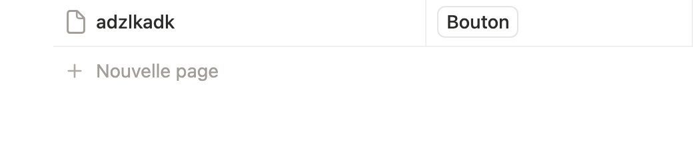
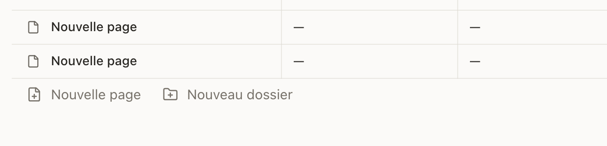
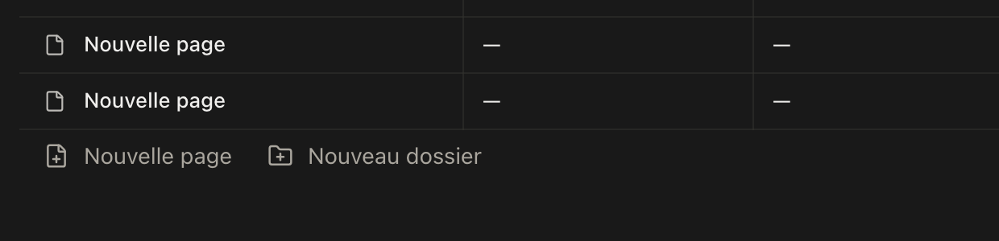

# Validation: Chrome de table

**Feature**: 043-database-table-chrome
**Date**: 2026-11-04

## Preuves visuelles

Instance locale `https://localhost:8443`, base de démonstration :
[table complète](evidence/table-chrome-1440.png),
[tri actif et puce](evidence/active-sort-chip-1440.png),
[icône de tri dans la barre](evidence/toolbar-sort-1440.png),
[bouton « Nouveau »](evidence/toolbar-new-1440.png).

Constat : un seul titre, puce « Lien · croissant » retirable, ligne
« Nouvelle page / Nouveau dossier » en bas, compteur de lignes inchangé.

## Vérifications

```sh
bunx vitest run --project web apps/web/tests/database-*.spec.tsx  # 53 tests
bun run --filter @myownnotion/web typecheck                       # OK
bun run --filter @myownnotion/web build                           # OK
```

## Limites

- La barre d'outils contient filtre, tri, réglages et bouton primaire
  « Nouveau » ; la recherche dans la vue reste à faire.
- Le pied de table n'a pas encore de calculs (comptage, somme).
- La puce de filtre affiche le nom et l'opérateur, pas encore la valeur.

## Parité de la ligne d'ajout (2026-11-06)

Référence Notion mesurée avec l'outil de parité (base de test, 1440 px) :

```sh
bun run notion:parity:capture --profile .notion-lab/profile \
  --url "<base de test Notion>" \
  --steps scripts/notion-parity/recipes/notion-add-entry.json \
  --selector ".notion-table-view-add-row" --item ".notion-table-view-add-row" \
  --out .notion-lab/parity/notion-add-entry
bun run notion:parity:capture --profile .notion-lab/app-profile-8080 \
  --url "http://127.0.0.1:8080/notes/<base>" \
  --steps scripts/notion-parity/recipes/myownnotion-add-entry.json \
  --selector "tr.database-table-add-entry .ui-button:first-child" \
  --item "tr.database-table-add-entry .ui-button" \
  --out .notion-lab/parity/myownnotion-add-entry
bun run notion:parity:compare \
  --reference .notion-lab/parity/notion-add-entry/capture.json \
  --candidate .notion-lab/parity/myownnotion-add-entry/capture.json \
  --out .notion-lab/parity/add-entry/comparison.md
```

Résultat : `Nouvelle page` est au même endroit, avec les mêmes métriques de
pilule (28 px, rayon 6, padding-inline 8, 14 px/400) et le même survol au voile
translucide ; l'icône (327) et le libellé (352) restent sur la colonne titre.
Le candidat a un item de plus, `Nouveau dossier` : c'est une action propre à
MyOwnNotion, absente de Notion, à valider par le propriétaire.





## Création d'entrée : fin de liste et affichage immédiat (2026-11-06)

- **Ordre par défaut** : une vue sans tri explicite suit l'ordre de création
  (`createdAt`) ; la nouvelle entrée est donc toujours en fin de liste. Un tri
  explicite reste prioritaire, comme dans Notion.
- **Ligne optimiste** : l'id est généré par la page, la ligne est peinte
  immédiatement en fin de grille avec cet id, le titre s'ouvre tout de suite et
  les saisies faites pendant l'écriture locale sont mises en file puis
  appliquées à la résolution.
- **Mesure locale** (dev, 1440 px) : ligne et champ de titre visibles à ~213 ms
  après le clic ; entrée en dernière position (13/13) ; titre tapé pendant
  l'écriture conservé. L'entrée de mesure a été mise à la corbeille après le
  relevé.
- **Tests** : `database-page-interaction` (ligne avant écriture, titre immédiat,
  renommage différé appliqué, échec qui retire la ligne) et `query.property`
  (ordre de création, tri explicite prioritaire).

## En-tête d'ajout de propriété (2026-11-10)

Avec une seule colonne, le libellé « Ajouter une propriété » est maintenant
rendu **dans** le bouton (icône + texte) et la colonne d'ajout s'élargit
(180 px) : il n'est plus coupé par la cellule de remplissage, et cliquer sur le
texte ouvre la saisie de la nouvelle propriété. Dès que la table a plusieurs
colonnes (les « … » à droite), le libellé n'est plus rendu : seuls + et …
restent. Preuves : [054 evidence](../054-ui-parity-errors/evidence/add-property-single-button-light.png),
[-dark](../054-ui-parity-errors/evidence/add-property-single-button-dark.png),
[multi](../054-ui-parity-errors/evidence/add-property-multi-header-end.png).

## Libellé d'ajout sous le panneau de paramètres (2026-11-10)

Quand le panneau de paramètres de vue recouvre l'en-tête d'ajout sur un écran
étroit, la pilule est bornée juste avant le panneau et le libellé s'ellipse au
lieu d'être coupé ; le calcul suit l'ouverture animée, le défilement et le
redimensionnement. Large écran : le libellé reste entier. Preuves :
[816 px ouvert](../054-ui-parity-errors/evidence/add-property-panel-ellipsis-816.png),
[1440 px ouvert](../054-ui-parity-errors/evidence/add-property-panel-open-1440.png).
